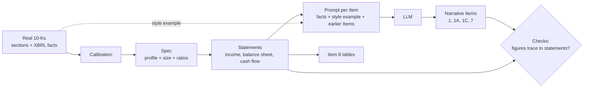

# Synthetic 10-K reports (team BMO-1)

Two methods that build fictional companies' 10-K filings, and shared evals that check each method's output with both methods' validators. The methods were built in parallel, use different data and approaches, and are kept separate so either can be run, compared, or reused. Method 1 was built by Amin Kharaghani and Method 2 by Dylan Nguyen.

```
synthetic_10k/
  README.md       this overview
  method_1/       Method 1: Python package (python -m method_1.<step>), tests, README
  method_2/       Method 2: Python package (python -m method_2.<step>), config, data/, PLAN.md
  RAG/            retrieval benchmark and chatbot over the synthetic + real corpus (built on Method 2)
  evals/          cross-method validation scripts, the gap and privacy reports, results
  dashboard/      self-contained results dashboard and the chatbot UI (built on Method 2)
  data/           one folder per generated batch: data/<batch>/{method_1, method_2, evals}
  run_batch.sh    one batch from both methods with the same model and sections, plus evals
```

## Setup

The whole repository has one environment, the `.venv` at its root. The packages both methods, RAG and the evals need are the `synthetic-10k` group in the root `pyproject.toml`, which a plain `uv sync` installs. Every command runs from this folder, so `method_1`, `method_2`, `RAG`, `evals` and `dashboard` import as packages with no `PYTHONPATH`.

```bash
uv sync                                  # once, from the repository root
cd implementations/synthetic_10k
uv run pytest method_1/tests             # Method 1's unit tests
uv run python -m method_1.narrative --help
uv run python -m method_2.step08_generate_filings --help
```

## RAG, extra evals and dashboard (from Method 2)

These modules build on Method 2 and import the `method_2` package, so run them from this folder with `uv run python -m ...`. They read and write `method_2/data/`.

| Folder | Script | Output |
|---|---|---|
| `RAG/` | `chunks.py`, `retrieval.py`: paragraph chunking; BM25, a semantic embedding retriever (fastembed locally, or `text-embedding-*` models through Vector's proxy with `RAG_EMBEDDING_MODEL`), reciprocal rank fusion and ranking metrics | |
| `RAG/` | `step11_make_qa.py`: QA pairs with a gold passage each | `method_2/data/qa_pairs.csv` |
| `RAG/` | `step12_evaluate_retrievers.py`: BM25, semantic and hybrid retrieval on synthetic, real and mixed corpora | `method_2/data/retrieval_eval.csv` |
| `RAG/` | `chatbot.py`, `chatbot_server.py`: RAG chatbot demo (CLI and browser UI) | |
| `evals/` | `step13_gap_report.py`: synthetic-vs-real gap (length, vocabulary, numbers, retriever ranking) | `method_2/data/gap_report.csv` |
| `evals/` | `step14_privacy_check.py`: distance of each fictional company's financials from its real template | `method_2/data/privacy_report.csv` |
| `evals/` | `compare_sets.py`: fidelity, utility (retrieval) and privacy for several synthetic sets side by side, with `text-embedding-3-small` | `evals/results/compare_sets/comparison.md` |
| `dashboard/` | `build_dashboard.py`: embeds the five result CSVs and vendored d3 into `template.html` | `dashboard/index.html` |

```bash
cd implementations/synthetic_10k
uv run python -m method_2.step03_build_index   # index of real + synthetic filings
uv run python -m RAG.step11_make_qa
uv run python -m RAG.step12_evaluate_retrievers
uv run python -m evals.step13_gap_report
uv run python -m evals.step14_privacy_check
uv run python -m dashboard.build_dashboard    # then open dashboard/index.html
```

Details are in [method_2/README.md](method_2/README.md) and `method_2/PLAN.md` (Phases 8-11).

## Generate a batch with both methods

[`run_batch.sh`](run_batch.sh) generates N fictional companies with each method using the same model on Vector's proxy and the same sections (Items 1, 1A, 1C, 7, 8), then runs every eval on both batches. Run it from the repository root on the Coder workspace; the settings are at the top of the script.

```bash
RUN=gemini20 N=20 MODEL=gemini-3-flash-preview bash implementations/synthetic_10k/run_batch.sh
```

## How the two methods differ

| | Method 1 ([README](method_1/README.md)) | Method 2 ([README](method_2/README.md)) |
|---|---|---|
| Real filings | 305 S&P 500 10-Ks filed in 2025 (mostly FY2024), main document only, from a local download | 50 S&P 500 companies sampled at random, FY2023 to FY2025, downloaded with edgartools, including EX-13 exhibits |
| Sections parsed | Items 1, 1A, 1C, 7, 7A, 8, plus every inline XBRL fact in the filing | Items 1, 1A, 1C, 7, 8; XBRL facts from SEC's companyfacts API |
| Calibration | Per GICS sector: percentiles of about 20 ratios and of section lengths | Generic across sectors: percentiles of 6 totals and 6 ratios |
| Fictional company | Ratios sampled from its sector's percentiles | One real company-year as a template, scaled by a random size factor |
| Statements | Two years (current and prior), income statement, balance sheet, cash flow | One year, line items from the template company's own ratios |
| Narrative | Written by an LLM through Vector's proxy (Gemini by default), with checks and up to 3 retries per section | One LLM call per section, no retries. The committed 20 companies were written in a Claude Code session; `step08` generates new batches through Vector's proxy or the Anthropic API |
| Output | Items 1 to 16 as text, plus an EDGAR-style HTML and PDF filing | Items 1, 1A, 1C, 7, 8 as text (condensed by design) |
| Built-in checks | `validate.py`, run on each section during generation | `step09_validate_filings.py`, run on the finished filings |

## How each method makes the numbers and the text

Both methods follow the same rule: **code fixes every number first, then an LLM writes prose around those numbers.** The LLM never decides a figure. The methods differ in where the numbers come from, what the LLM is shown, and when the text is checked.



### Method 1: sector statistics, checked while writing

1. **Calibration** (`calibrate.py`): from 305 real 10-Ks, per GICS sector, the 10th to 90th percentiles of company size (log revenue), about 20 ratios (gross and operating margin, SG&A, R&D, D&A and capex intensity, tax rate, asset turnover, equity, current, cash, PP&E, debt, receivables, inventory, goodwill, payout) and of each Item's length.
2. **Spec** (`specs.py`): picks a sector in proportion to its real filers, then draws each ratio independently from that sector's percentiles. It then clamps the draws so they fit together (for example, operating costs must fit inside gross profit). Name and ticker are invented from syllables and checked against every real filer.
3. **Statements** (`statements.py`): builds two fiscal years (the prior year's ratios are lightly perturbed) of income statement, balance sheet and cash flow in whole $ millions. "Other" lines absorb the residuals, so every identity holds exactly. Specs that fail an accounting or plausibility check are redrawn.
4. **Prompt** (`narrative.py`, `render.py`): a facts sheet with the profile, both years' statements and code-computed percentages (margins, year-over-year changes), so the LLM never does arithmetic. Each prompt also has a 1,200-word excerpt of the same Item from a real company in the same sector, the Items already written, and a length target drawn from the sector's real lengths (capped to keep cost down).
5. **Writing and checks** (`validate.py`): each Item is checked as soon as it is written. The checks cover the heading, length, the company's name, real company names, copying from the style example (at most 5% of 8-word sequences), leaked variable names and how many dollar amounts the Item cites. In Item 7, every amount and percentage must also appear in the facts sheet. A failing Item is rewritten with the problems as feedback, up to 3 drafts.
6. **Item 8 and the rest**: Item 8 is rendered from the statements by code, never by the LLM. Items 2, 3 and 7A are LLM-written, and Items 1B, 4, 5, 6 and 9 to 16 come from templates. `export.py` assembles an EDGAR-style `filing.html`.

### Method 2: a disguised real company, checked afterwards

1. **Calibration** (`step05_make_calibration.py`): from the companyfacts XBRL of 50 sampled S&P 500 companies (FY2023 to FY2025), one record per company-year (147 in total), with 6 totals and 6 ratios.
2. **Spec** (`step06_make_specs.py`): picks one real company-year as a template, keeps its sector, sub-industry and HQ state, and scales its totals by a random 0.7 to 1.4 with 0.85 to 1.15 jitter per ratio. It also draws Item 1C facts (framework, board oversight, whether an incident was disclosed) and checks the name against all 503 S&P 500 names and tickers.
3. **Scenario** (`step06b_add_scenarios.py`): a storyline per company (acquisition, product launch, cash burn, ...). The scenarios are hand-written for the committed 20 companies, and `run_batch.sh` doesn't add them to new batches.
4. **Statements** (`step07_make_financials.py`): one fiscal year, in dollars. Each line item is the template company's own share of its total, applied to the fictional total, with one "other" line per statement so it reconciles exactly.
5. **Prompt** (`step08_generate_filings.py`): the profile, only the figures that Item needs, the Items already written, the same Item from the template company itself as a style example (first 6,000 characters), and the median real length. The scenario is not in the prompt.
6. **Writing and checks**: one call per Item, in the order 1, 1A, 7, 1C, 8, with no checks while writing. **Item 8 is written by the LLM** from the statement JSON. Afterwards, `step09_validate_filings.py` checks for real names and the template's name, whether the Item 7 and 8 figures trace to the statements (it also accepts sums and ratios of lines), the Item 8 headings, minimum length and whether the scenario appears in the text.

## Text and tabular data, and how they connect

Each filing has two kinds of synthetic data:

| | Tabular | Text |
|---|---|---|
| What | The spec (profile, size, ratios) and the financial statements | Narrative Items 1, 1A, 1C, 7 (Method 1 also 2, 3, 7A) |
| Made by | Code, from calibration statistics (Method 1) or a scaled real template (Method 2) | An LLM, conditioned on the tabular data and a real style example |
| Exact? | Yes: every identity reconciles by construction | No: checked afterwards for figures, names, copying and length |
| Method 1 files | `synthetic/specs/{id}.json` (spec + statements) | `synthetic/filings/{id}/item_*.txt`, `filing.html` |
| Method 2 files | `{id}/{fy}/spec.json`, `financials.json` | `{id}/{fy}/item_*.txt` |

The link runs one way. The tables are fixed first and passed into each prompt, so each figure in the text should be a copy of a table value. The checks then test that link in reverse: every dollar amount and percentage in the text has to trace back to a table line or a value derived from one. That trace rate is the main measure of text-to-table consistency.

How much of the tables each Item gets, and so how tightly it is tied to them:

| Item | Method 1: figures given / allowed | Method 2: figures given | How tightly tied to the tables |
|---|---|---|---|
| 1 Business | Full facts sheet; at most 3 dollar amounts, guidance says revenue only; employees | Revenue only | Loose: qualitative, one or two figures |
| 1A Risk Factors | Full facts sheet; told to quote no amounts (at most 4) | Total assets, liabilities, equity | Loose: exposures described in words |
| 1C Cybersecurity | Facts sheet; no amounts allowed | Framework, oversight and incident flag (spec, not statements) | None: no financial figures |
| 7 MD&A | Both years' statements and derived percentages; every figure must trace | The full single-year statements | Tight: the most numeric text Item |
| 8 Financial Statements | Rendered by code, so exact | Written by the LLM from the statement JSON | Is the table itself |

### What this suggests per section (to test with the per-section evals)

- **Items 1, 1A, 1C:** mostly text, so the comparison is about realism, variety and privacy. Method 2's style example is the template company's own Item, which may make its text more specific, but it raises the risk of carrying over that company's real business. Method 1 uses a different company from the same sector and rejects drafts that copy it.
- **Item 7:** Method 1 has two years and precomputed changes, so its MD&A can compare years as real MD&As do. Method 2's single year can't, and the LLM has to work out any ratio itself.
- **Item 8:** Method 1's tables are exact by construction. Method 2's depend on the LLM copying the JSON correctly, which likely explains part of its low trace rate on Gemini.

## Build Day 2 result: which method per section

Six batches were scored Item by Item against real 10-Ks with [`evals/section_scorecard.py`](evals/README.md#per-section-scorecard-choosing-a-method-per-item) and [`evals/compare_sets.py`](evals/README.md#compare-synthetic-sets-fidelity-utility-privacy): Method 1 and Method 2, each on Gemini 3 Flash (`gemini-3-flash-preview`, 20 companies), GPT-4o (20) and Claude Opus 5.5 (`claude-opus-5-5`; 20 for Method 1, 10 for Method 2). Results are in [`evals/results/day2_scorecard/`](evals/results/day2_scorecard/) (with a shareable `scorecard.html`), [`evals/results/day2_compare_sets/`](evals/results/day2_compare_sets/) and the per-batch eval folders `data/{gemini20,gpt4o20,opus20}/evals/`.

**Build on Method 1.** Its figures trace to the statements 99–100% of the time on every model. A RAG benchmark needs that, because a question's gold answer has to be the number in the statements. Method 2 writes the most realistic-looking text, but only 46–74% of its figures trace.

| Item | Use | Why |
|---|---|---|
| 1 Business | Method 1 + Opus | 100% traced; the longest Method 1 text (0.56× real) with the closest vocabulary |
| 1A Risk Factors | Method 1 + Gemini (Opus if budget allows) | Few figures, so realism decides; best vocabulary match among complete sets |
| 1C Cybersecurity | Method 1 + Gemini | No figures; every set is near real length |
| 7 MD&A | Method 1 + Opus (Gemini on a budget) | 99.5% traced and the most answerable fact questions (73 of 100) |
| 8 Financial Statements | Method 1, any model | Rendered by code, so exact; Method 2's LLM-written Item 8 traces 23–76% |

| | Gemini | GPT-4o | Opus |
|---|---|---|---|
| Method 1 companies passing its own validation | 8/20 | 0/20 (too short) | 19/20 |
| Method 1 cost (20 companies) | Vector proxy | about $5 (proxy) | about $19 |
| Method 2 cost | Vector proxy | Vector proxy | about $30–35 for 10; the content filter blocked 7 of 10 Item 8s |

Real 10-Ks trace only 12–14% of their figures to their own XBRL headline numbers. The rest are segment, quarterly and per-share figures. So Method 2's lower score is partly real-like detail, but those figures have no checkable answer in a benchmark. Every set's copying from real filings is at or below the real baseline. Next for Method 1: less repetition across companies (Item 7 repeats 13–19% of 8-word sequences, against 2% in real filings) and longer sections.

## Evals

[`evals/`](evals/README.md) runs each method's validator on the other method's filings, without changing either validator.

| Validator | Run on | Checks | Pass | Fail | Result |
|---|---|---|---|---|---|
| Method 2's step09 | its own 20 companies | 360 | 260 (+100 info) | 0 | [report](method_2/data/validation_report.csv) |
| Method 2's step09 | Method 1's 2 showcase filings | 36 | 22 (+10 info) | 4 | [report](evals/results/method2_gates_on_method1_showcase/validation_report.csv) |
| Method 1's checks | Method 2's 20 companies | 400 (+100 skipped) | 375 | 25 | [report](data/claude20/evals/method1_checks_on_method2/validation_report.csv) |

None of the failures is a defect in a filing. Each one comes from a difference in what the two validators expect:

- **Method 2's checks on Method 1's filings:** Method 2's Item 8 heading pattern accepts only "Statement of Operations", not the plural that Method 1's filings use (2 failures). Its number check expects single-year filings, so it flags year-over-year changes and prior-year margins in MD&A (2 failures, 17 figures). Every figure in Item 8 traces to the statements.
- **Method 1's checks on Method 2's filings:** Method 1's number check allows fewer derived figures. Every figure behind the 25 failures is one that Method 2's check accepts, such as a sum of lines (total debt) or a ratio Method 1's check doesn't compute. No real company names, leaked variable names or missing company names were found.
- The exemplar-overlap check (copying from the real template filing) was skipped for Method 2's filings, because its parsed real filings are git-ignored. It runs automatically where `method_2/data/parsed/` exists.
